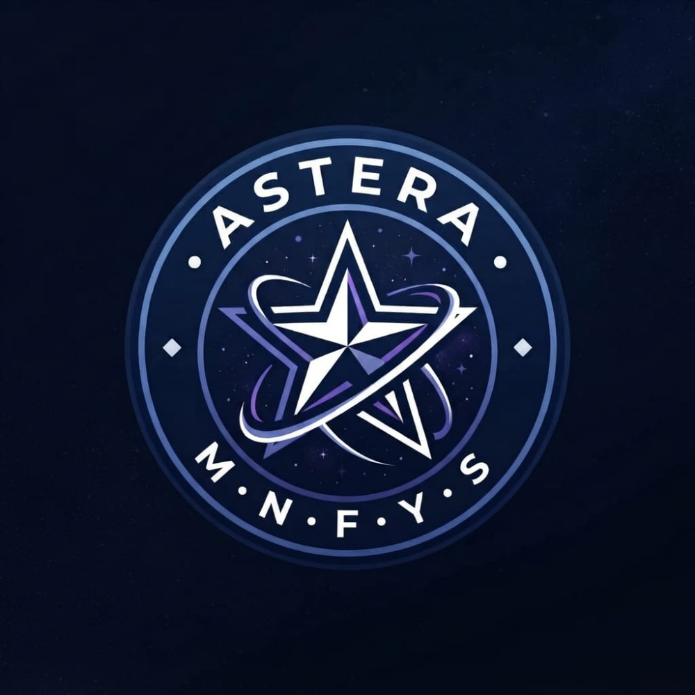

<p align="center">
  
</p>

<h1 align="center">Astera Watch</h1>
<p align="center"><em>Wildfire Surface-Change Monitoring with NASA NISAR Radar</em></p>
<p align="center">Team Astera · NASA Space Apps Challenge</p>

---

Astera Watch is a web application for exploring possible wildfires and the surface changes radar satellites
can detect around them. People explore a world map of satellite heat detections, search for a country, select a
possible fire, and read what is known and what isn't. Each possible fire has a "Fire Story" bringing together its
heat detections, before-and-after radar images and the radar change analysis. The target radar mission is NASA–ISRO
**NISAR**.

> **Status:** the **frontend is built and runs on synthetic demo data**. The backend API, the processing pipeline and
> live data connections are **not built yet**. Details: [docs/PROJECT_STATUS.md](docs/PROJECT_STATUS.md).
>
> Demo data is always labelled. It is never presented as real satellite observations.

## Key capabilities (frontend, on demo data)

- **Fire map:** natural geographic background (Natural Earth), possible-fire markers at world scale, FIRMS detection
  density squares at regional zoom, individual heat spots close up, and country search.
- **Fire Story** for each possible fire: what we know and what we don't know yet, a heat-spot timeline,
  before/after radar availability, the radar analysis (estimates with uncertainty), and JSON/CSV downloads.
- **Fire History & Impacts**, **My Places** (saved in the browser; alerts not available yet), **User Guide**,
  **How It Works**, and Help with **Ask Astera** (chatbot: coming soon).
- Light (default) and Dark themes, desktop and phone layouts, WCAG 2.2 AA checks.

## Quick start

Prerequisites: Windows, Node.js 22 (≥ 22.13) with npm. Python, Conda and PostgreSQL are only needed for backend work.

```powershell
cd frontend
npm ci
npm run dev        # http://localhost:5173
```

Checks: `npm run typecheck`, `npm run lint`, `npm test`, `npm run build` (from `frontend/`).
Full setup: [docs/setup/DEVELOPMENT.md](docs/setup/DEVELOPMENT.md). Tests: [docs/setup/TESTING.md](docs/setup/TESTING.md).

## Documentation

| Read this | For |
|---|---|
| [docs/HANDOVER.md](docs/HANDOVER.md) | Step-by-step guide for a developer taking over |
| [docs/PROJECT_STATUS.md](docs/PROJECT_STATUS.md) | What's done, demo-only, planned; known issues; open decisions |
| [docs/architecture/OVERVIEW.md](docs/architecture/OVERVIEW.md) | How the parts fit together |
| [docs/architecture/FRONTEND.md](docs/architecture/FRONTEND.md) · [BACKEND.md](docs/architecture/BACKEND.md) · [DATABASE.md](docs/architecture/DATABASE.md) | Each part in detail |
| [docs/data/DATA_SOURCES.md](docs/data/DATA_SOURCES.md) | Data sources, licences, and what each can and can't establish |
| [docs/setup/DEVELOPMENT.md](docs/setup/DEVELOPMENT.md) · [TESTING.md](docs/setup/TESTING.md) | Setup and checks |
| [docs/ROADMAP.md](docs/ROADMAP.md) | The staged plan and team ownership |
| [docs/design/](docs/design/README.md) | Visual identity and design tokens |

## Repository layout

```
astera-wildfire-platform/
├── frontend/          React + TypeScript + Vite web app (built; demo data)
│   ├── src/           app shell, pages (features/), data layer (data/), components
│   ├── public/        logo, brand marks, Natural Earth basemap files
│   └── scripts/       design-token generator, test launcher, browser checks
├── backend/           FastAPI app and SAR processing library (empty skeleton)
├── notebooks/         planned analysis notebooks (empty)
├── data/              mock/, raw/, processed/, outputs/ (satellite files; not committed)
├── docs/              architecture, setup, data, design, roadmap, stage reports
├── environment.yml    Conda env `astera` (Python 3.11, GDAL, FastAPI, …)
└── .env.example       configuration template (copy to .env; never commit .env)
```

## Data sources

| Source | Role | Status |
|---|---|---|
| NASA NISAR (GCOV / GSLC, via ASF) | Primary radar data | Planned; product layout unverified |
| NASA FIRMS | Active-fire detections, used for event discovery only, **never as burned area** | Planned |
| Copernicus Sentinel-1 | C-band test data during development; never presented as NISAR | Planned |
| Natural Earth | Country outlines, names, shaded-relief background (public domain) | In use |
| Synthetic demo data | Development and demonstration, always labelled | In use |

## Scientific principles

- FIRMS detections are thermal anomalies, not confirmed fires and not burned-area boundaries.
- Radar-derived surface change is an estimate with uncertainty, not proof of burned area. There are no universal
  thresholds, and NISAR (L/S-band) and Sentinel-1 (C-band) processing assumptions are not interchangeable.
- The map background is long-term geographic context, not current vegetation.
- Missing metadata stays missing. It is reported, never invented.
- Synthetic data is never presented as real observations.
- Astera Watch is not an emergency service. Safety and evacuation can't be inferred from satellite data; follow local
  authorities.

## Team

Team Astera: six members. Module ownership is in [docs/ROADMAP.md](docs/ROADMAP.md#team-ownership). Licence: [MIT](LICENSE).
