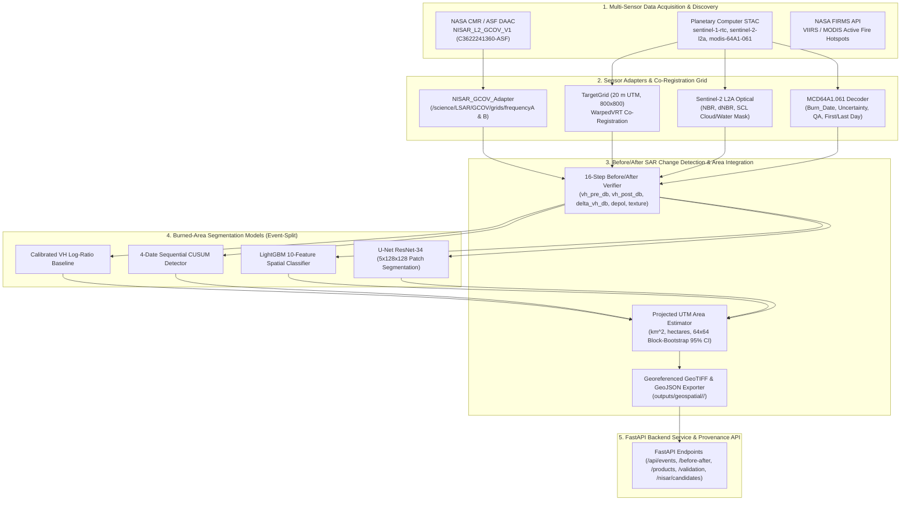

# Astera Watch — System & Scientific Architecture

**Challenge:** NASA Space Apps Challenge 2026 — *Dancing with the SARs*  
**Platform:** Astera Watch — NISAR-Targeted Wildfire Monitoring & Burned-Area Intelligence Platform

---

## 1. End-to-End Architecture Overview

Astera Watch is organized into five strictly separated layers:

---

## 2. Repository Module Map

| Module Path | Responsibility |
| :--- | :--- |
| `backend/processing/acquisition/event_specs.py` | Verified 2026 California wildfire event catalogue (`CA_GANN_2026`, `CA_TIMBER_2026`, `CA_DOME_2026`, `CA_BUG_2026`), split assignments (`TRAIN`/`VAL`/`TEST`), and orbit/date windows. |
| `backend/processing/acquisition/asf_client.py` | NASA CMR (`C3622241360-ASF` & `C2854338529-ASF`), `asf_search`, and NASA Harmony OGC API Coverages client for `NISAR_L2_GCOV` granule discovery (`170` granules, `15` matched pre/post pairs), CRID/PGE maturity parsing (`P05023` vs `P05036`), outage window checking (`2026-07-27` to `2026-08-10`), and spatial/variable subset URL generation. |
| `backend/processing/acquisition/planetary_computer.py` | Anonymous STAC search and SAS token signing with exponential backoff for `sentinel-1-rtc`, `sentinel-2-l2a`, and `modis-64A1-061`. |
| `backend/processing/acquisition/firms_client.py` | NASA FIRMS active fire hotspot client with UTC timestamp normalization and VIIRS/MODIS confidence normalization (`LOW`, `NOMINAL`, `HIGH`). |
| `backend/processing/adapters/nisar_gcov_adapter.py` | Specification-compliant HDF5 reader and validator for `NISAR_L2_GCOV_V1` (`frequencyA` & `frequencyB`), dynamic covariance term discovery (`HHHH`, `HVHV`, `VVVV`, `VHVH`, complex off-diagonal terms), subswath `mask` decoding (`0`, `1..254`, `255`), and $\gamma^0 \to \sigma^0$ conversion via `rtcGammaToSigmaFactor`. |
| `backend/processing/preprocessing/grid.py` | 20 m local UTM `TargetGrid` (`800 × 800`, $16\text{ km} \times 16\text{ km}$) construction and `WarpedVRT` multi-sensor co-registration. |
| `backend/processing/preprocessing/optical.py` | Sentinel-2 L2A NBR, dNBR, and `SCL` cloud/shadow/snow/water masking (`SCL_VALID_CLASSES = (4, 5, 6, 7)`). |
| `backend/processing/preprocessing/mcd64a1.py` | `MCD64A1.061` (`C2565786756-LPCLOUD`) decoder for `Burn_Date`, `Uncertainty`, `QA` 8-bit bitfields, `First_Day`, and `Last_Day`. |
| `backend/processing/change_detection/before_after.py` | 16-step Before-Fire vs After-Fire scientific verification, multi-polarization SAR change computation, projected UTM area integration ($\text{km}^2$, $\text{ha}$, block-bootstrap CI95), and GeoTIFF/GeoJSON export. |
| `backend/processing/models/` | `UNetResNet34` (PyTorch 5-channel encoder-decoder), `LightGBMBurnedAreaClassifier` (10-feature spatial GBDT), `LogRatioDetector`, `CUSUMDetector`, and leakage-free patch dataset builder. |
| `backend/processing/validation/metrics.py` | Pixel confusion matrix, Precision, Recall, F1, IoU, Dice, Specificity, FPR, FNR, ROC-AUC, PR-AUC, and area error percentage. |
| `backend/app/` | FastAPI application (`main.py`, `api/endpoints.py`, `services/analysis_service.py`, `schemas/api_schemas.py`). |

---

## 3. REST API Contract (`/api/*` and `/api/v1/*`)

All API routes are mounted at both `/api` and `/api/v1` and include explicit `provenance` metadata (`sensor`, `collection`, `product_version`, `acquisition_timestamps`, `event_id`, `data_origin`, `processing_version`, `model_version`, `reference_source`, and `project_maturity_status`).

| Method & Endpoint | Description |
| :--- | :--- |
| `GET /health` | Root platform health, data origin (`CROSS_SENSOR_PROTOTYPE`), and explicit `is_nisar: false` status. |
| `GET /api/health` | API subsystem readiness (`geospatial_ready`, `ml_ready`). |
| `GET /api/events` | Lists verified wildfire events (`?include_excluded=true` includes `CA_TIMBER_2026`). |
| `GET /api/events/{event_id}` | Returns metadata for a specific wildfire event. |
| `GET /api/events/{event_id}/before-after` | Returns the 16-step Before/After verification, radiometric $\Delta\gamma^0$ summary, projected burned-area estimates ($\text{km}^2$, $\text{ha}$, CI95), and product links. |
| `GET /api/events/{event_id}/products` | Lists all georeferenced GeoTIFF and GeoJSON files generated for the event with byte sizes and CRS metadata. |
| `GET /api/events/{event_id}/validation` | Returns independent validation metrics against Sentinel-2 $\text{dNBR}$ and QA-filtered NASA MODIS `MCD64A1.061` (including ROC-AUC and PR-AUC). |
| `GET /api/nisar/candidates` | Returns live-verified NASA CMR (`C3622241360-ASF`) NISAR L2 GCOV pre/post candidate pairs, CRID maturity (`P05023` vs `P05036`), and outage status. |
| `POST /api/analysis/run` | Evaluates a requested `event_id` and `model_type` (`unet`, `lightgbm`, `log_ratio`, `cusum`, `all_burned`) using reproducible stored experiment artifacts. |
| `GET /api/analysis/{job_id}/results` | Retrieves cached job results by `job_id`. |
| `GET /api/models/comparison` | Returns the full multi-model evaluation report across `TRAIN`, `VAL`, and held-out `TEST`. |
