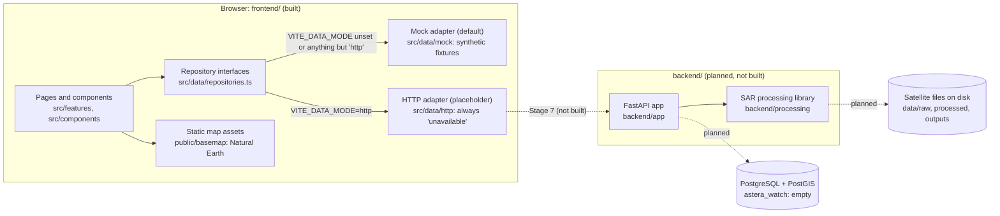

# Architecture overview

Astera Watch has three planned parts. Only the frontend is built today.

| Part | Folder | Status |
|---|---|---|
| Web app (React + TypeScript + Vite + MapLibre) | `frontend/` | **Built**, runs on synthetic demo data |
| API (FastAPI) and SAR processing library (Python) | `backend/` | **Skeleton only**: empty Python packages, no endpoints, no processing code |
| Database (PostgreSQL 18 + PostGIS 3.7, local install) | set up by `docs/setup/create_databases.sql` | **Created and verified, but empty**: no tables or migrations |

## How the parts relate

- **The frontend never calls a server today.** All data comes from the mock adapter (`src/data/mock/`), which serves
  synthetic records. Every one is labelled synthetic in its provenance, and the app shows a "Demo data" bar.
- **The data layer is the seam for the backend.** Pages only talk to the repository interfaces in
  `frontend/src/data/repositories.ts` (through TanStack Query hooks in `src/data/hooks.ts`). The planned backend
  integration (roadmap Stage 7) replaces the HTTP placeholder adapter with a real one. No page needs to change.
- **The frontend types are provisional** (`src/data/types/`). They describe what the pages need. The backend contracts
  (roadmap Stage 1) do not exist yet, so no API shape, endpoint or URL is assumed anywhere in the frontend.
- **Satellite files never go into the database** (project rule). The database is meant for metadata, footprints and
  file references; files live under `data/`.
- **The map is fully local:** Natural Earth files in `frontend/public/basemap/` (public domain). There are no external
  tile servers, fonts or sprites.

## Where to read next

| Topic | Document |
|---|---|
| Frontend structure, routing, state, map, themes | [FRONTEND.md](FRONTEND.md) |
| Backend status and the planned API | [BACKEND.md](BACKEND.md) |
| Database setup and the planned schema | [DATABASE.md](DATABASE.md) |
| Data sources and what they can and can't establish | [../data/DATA_SOURCES.md](../data/DATA_SOURCES.md) |
| Status, known issues, next steps | [../PROJECT_STATUS.md](../PROJECT_STATUS.md) |
| Staged plan | [../ROADMAP.md](../ROADMAP.md) |
