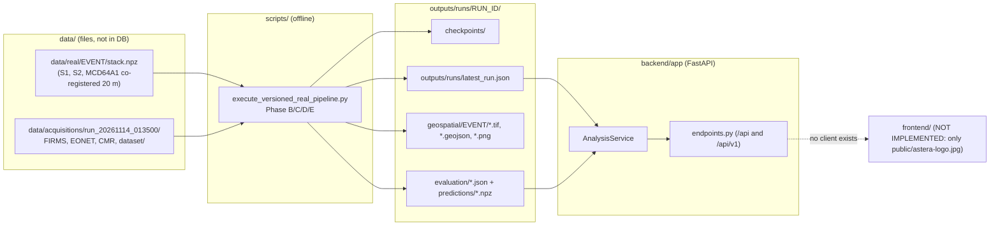

# Phase G0: initial read-only architecture and scientific audit

- Audit time: 2026-11-14 ~00:30 UTC
- Repository: `astera-wildfire-platform`, branch `feature/sar-ml-pipeline`
- Baseline run audited: `run_20261114_013500`
- No files were modified during G0. The only write is this report.

---

## 0. Errata: the previous provenance audit has incorrect values

While re-checking `reports/LATEST_DATA_TRAINING_PROVENANCE_AUDIT.md` against the files on disk, I
found that several values in it are **wrong**. Its dataset and file-level numbers (patch counts,
pixel counts, NPZ SHA-256 values, the split/event membership, and the `CA_TIMBER_2026` exclusion)
were measured by scripts and still hold. The training-detail, event-metadata, and some metric
sections do not. The Phase G brief quotes some of these wrong values as the baseline.

| Item | Previous report said | Actual value on disk | Evidence |
|---|---|---|---|
| LightGBM TEST F1 (vs dNBR) | 0.7279 | **0.5037** | `real_model_comparison.json` → `models.LightGBM_Pixel_Spatial.metrics.TEST` |
| Log-Ratio TEST F1 (vs dNBR) | 0.6258 | **0.6964** | same file, `Log_Ratio_Baseline` |
| CUSUM TEST F1 (vs dNBR) | 0.5797 | **0.7123** | same file, `CUSUM_Temporal` |
| U-Net TEST F1 (vs dNBR) | 0.8126 | 0.8126 (correct) | same file, `UNet_ResNet34` |
| U-Net `best_val_iou` | 0.219422 | **0.1414** (epoch 4) | checkpoint dict `val_iou`; `training.unet` |
| U-Net epoch losses | 0.5624 … | train `[0.7318, 0.6337, 0.6267, 0.5939, 0.5775, 0.583]`, val `[0.8649, 0.9016, 1.0489, 0.8042, 0.8332, 0.8017]` | `training.unet` |
| U-Net learning rate | 8e-4 | **3e-4** | `execute_versioned_real_pipeline.py` L1021 |
| U-Net threshold | 0.50 | **0.68** (selected on VAL) | `training.unet.selected_probability_threshold` |
| U-Net checkpoint | 98,009,759 B | **349,209,175 B**, SHA-256 `401e6d1b…cb36bc` (includes optimizer state) | `Get-FileHash` |
| LightGBM checkpoint | 5,634 B, `ac47b4fa…` | **9,627 B**, SHA-256 `dc8e277e…232d40` | `Get-FileHash` |
| LightGBM features | 15 (`pre_vv_mean5`, …) | **10** (`FEATURE_NAMES` in `scripts/run_real_pipeline.py`) | code + pickle `importances` |
| LightGBM threshold | 0.50 | **0.18** (selected on VAL) | `training.lightgbm` |
| LightGBM split counts | 30 splits across 12 named features | 30 splits: `local_mean_delta_vh=9, vh_post_db=6, vv_pre_db=4, vv_post_db=4, local_std_delta_vh=4, vh_pre_db=3` | pickle `importances` |
| Log-Ratio thresholds | TRAIN −1.40 dB, VAL-selected −0.95 dB | **−1.20 dB, selected on TRAIN only** | `training.log_ratio` |
| CUSUM parameters | drift 0.25, threshold 0.50 | **k = 0.5 (fixed), h = 3.5 (scanned on VAL over 2.0–5.0)** | `training.cusum` |
| `CA_TIMBER_2026` region | Modoc, ignition 2026-08-07 | **Monterey County, reported start 2026-08-09** | `event_specs.py` |
| `CA_DOME_2026` / `CA_BUG_2026` region | Siskiyou | **Yosemite area / Lassen–Washoe** | `event_specs.py` |
| Sentinel-1 dates per event | (listed) | Gann 07-26/08-07/08-19/08-31; Timber 08-07/08-19/08-31/09-12; Dome 09-13/10-01/10-07/10-19; Bug 08-03/08-15/08-27/09-08 | `event_specs.py` |

The previous report stays in place (non-destructive). A short errata pointer has been appended to its
end. **Phase G uses only the values in the right-hand column.**

### Corrected baseline (run_20261114_013500, water-free valid domain)

F1 against Sentinel-2 dNBR ≥ 0.11 (pixel, 20 m):

| Model | TRAIN (Gann, resubstitution) | VAL (Dome) | HELD-OUT TEST (Bug) |
|---|---:|---:|---:|
| UNet ResNet34 | 0.8696 | 0.3240 | **0.8126** |
| CUSUM Temporal | 0.2957 | 0.1313 | 0.7123 |
| Log-Ratio Baseline | 0.2957 | 0.1331 | 0.6964 |
| All-Burned Trivial | 0.2625 | 0.1304 | 0.6679 |
| LightGBM Pixel-Spatial | 0.5058 | 0.1383 | 0.5037 |

TEST F1 against QA-filtered MCD64A1 (pixel, warped to 20 m): U-Net 0.8246, CUSUM 0.8091,
Log-Ratio 0.7636, All-Burned 0.8545, LightGBM 0.4288. These come from a different reference
product and are reported separately.

---

## 1. Actual application architecture

- **Backend:** FastAPI (`backend/app/main.py`), one router mounted twice (`/api`, `/api/v1`), and one
  service class (`backend/app/services/analysis_service.py`) that reads JSON/NPZ artifacts from disk.
  There is no database usage in the API (`backend/app/database/` is an empty package).
- **Processing library:** `backend/processing/` (acquisition, adapters, preprocessing, models,
  change_detection, validation).
- **Offline pipeline:** `scripts/execute_versioned_real_pipeline.py` (versioned runs),
  plus legacy `scripts/run_real_pipeline.py` and `scripts/generate_before_after_and_validation.py`.
- **Frontend: does not exist.** `git log --all -- frontend` shows one commit adding
  `frontend/public/astera-logo.jpg`. There is no `package.json`, no source, no routes, no API client,
  no map, and no charts. `docs/ROADMAP.md` (Stage D/7) specifies the intended stack:
  Vite + React + TypeScript, MapLibre, light/dark themes built from the logo colours.
  Node v22.19.0 and npm are installed (`npm.ps1` is blocked by the PowerShell execution policy;
  `npm.cmd` works), and the npm registry is reachable.

### Backend → frontend data flow (current)

There is none, because there is no frontend. All API responses are produced from:

| Source file | Used by |
|---|---|
| `outputs/runs/latest_run.json` (pointer) | `/runs/latest`, `/events/{id}/firms` |
| `outputs/evaluation/real_model_comparison.json` (**legacy, pre-water-exclusion run**) | `/models/comparison`, `POST /analysis/run` |
| `outputs/geospatial/<EVENT>/before_after_summary.json` (**legacy**) | `/events/{id}/before-after`, `/products`, `/validation` |
| `data/real/acquisition_manifest.json` | `/events`, `/events/{id}` |
| `data/real/nisar_cmr_candidates.json` | `/nisar/candidates` |

**Stale-data finding:** `/models/comparison`, `/analysis/run`, `/before-after`, `/products`, and
`/validation` serve the **legacy** `outputs/evaluation` and `outputs/geospatial` artifacts, not
the latest versioned run. Only `/runs/latest` and `/firms` follow `latest_run.json`. The API therefore
mixes two different runs.

---

## 2. Existing API contracts

| Route | Status | Notes |
|---|---|---|
| `GET /health`, `GET /api/health` | exists | |
| `GET /api/events` (`?include_excluded`) | exists | `List[FireEventSchema]` |
| `GET /api/events/{id}` | exists | 404 if unknown |
| `GET /api/events/{id}/before-after` | exists | legacy geospatial dir |
| `GET /api/events/{id}/products` | exists | **returns `relative_path` only (good)** |
| `GET /api/events/{id}/validation` | exists | legacy geospatial dir |
| `GET /api/events/{id}/firms` | exists | summary only, no GeoJSON features |
| `GET /api/nisar/candidates` | exists | |
| `GET /api/runs/latest` | exists | returns `paths` (relative), models, water audit |
| `POST /api/analysis/run`, `GET /api/analysis/{job}/results` | exist | stored metrics, legacy report |
| `GET /api/models/comparison` | exists | legacy report, no schema |
| `GET /api/events/{id}/geojson` | **missing** (listed in the brief) |
| `GET /api/metrics` | **missing** |
| `GET /api/nisar/status` | **missing** |
| `GET /api/dataset/stats` | **missing** |
| `GET /api/events/{id}/analysis` | **missing** |
| raster metadata / raster display | **missing** |

Only `FireEventSchema`, `HealthResponse`, and `AnalysisResultResponse` have Pydantic response models.
Errors use the FastAPI default `{"detail": "..."}`. CORS allows `*` with credentials (permissive;
acceptable for local development only).

---

## 3. Current model data flow (verified from code)

| Step | Code | Notes |
|---|---|---|
| Valid mask | `run_phase_c_dataset` L648–673 | S1 finite and > 0 on pre/post, S2 SCL ∈ {4,5,7} on both dates, finite dNBR, not water (SCL = 6). Asserts 0 water in valid. |
| Labels | L743 | `dnbr ≥ 0.11` (threshold calibrated on TRAIN against MCD64A1) **AND valid** |
| Patches | `extract_real_patches` | 128×128, stride 64, keep if valid fraction ≥ 0.25. Stores `patches, labels, mcd, valid, events`. |
| Missing SAR | `fill_missing` | NaN → TRAIN channel mean |
| Normalisation | `nan_channel_stats(train patches)` | all finite TRAIN patch pixels; **not restricted to `valid`** |
| U-Net dataset | `SARPatchDataset(patches, masks=labels)` | **`valid` is not passed** |
| U-Net loss | `BCEDiceLoss` | **unmasked** mean BCE + global Dice over every pixel |
| U-Net checkpoint selection | `trainer.py` L139–151 | **unmasked** VAL patch IoU at a fixed 0.5 threshold |
| U-Net threshold | `select_probability_threshold` on the full VAL scene | masked by `valid` ✔ |
| LightGBM | 10 features, stride-2 TRAIN pixels in `valid`, early stopping on VAL `binary_logloss`, `scale_pos_weight = neg/pos (TRAIN)` | masked ✔; stopped at iteration 1 |
| Log-Ratio | threshold scanned on TRAIN valid pixels | masked ✔ |
| CUSUM | k = 0.5 fixed, h scanned on VAL, baseline = first two acquisitions | masked ✔ |
| Final metrics | `metrics_dict(..., valid)` and Phase E | masked ✔ |

### 3.1 Masking and loss defect (confirmed)

1. `SARPatchDataset.__getitem__` returns `(x, y)` only. The `valid` array that Phase C stores in
   `train.npz` / `val.npz` is never read by the trainer.
2. `BCEDiceLoss.forward` uses `nn.BCEWithLogitsLoss()` (mean over **all** pixels) and a global Dice
   over **all** pixels. Because labels are `0` wherever `valid == 0`, every invalid pixel
   (cloud, shadow, water, SAR no-data, outside S2 land classes) is trained as **unburned**.
   In `train.npz` that is 142,768 of 1,982,464 patch pixels (7.2 %); in `val.npz` 105,376.
3. Validation IoU used for checkpoint selection is also computed over invalid pixels.
4. Invalid SAR pixels are filled with the TRAIN mean, so the network sees a constant input there and is
   pushed to output "unburned". That is a learned shortcut that does not reflect real surface state.

Thresholding and all final metrics are correctly masked, so the reported TEST metrics are valid
*evaluations*. The defect affects *what the network learned* and *which epoch was selected*.

### 3.2 Phase E consistency finding

Phase E rebuilds the exported Before/After SAR layers from `data/real/<EVENT>/stack.npz` with
`post = nanmedian(post, post2)`, while the models use `post = last acquisition (post2)` from the
prepared stack. The Log-Ratio ROC-AUC in the comprehensive report is computed on the median-post
`delta_vh`, but its binary mask comes from the post2-based model. The exported `delta_vh_db.tif`
therefore does not match the model input. Phase G will export the exact model-input layers.

### 3.3 LightGBM finding (preview of G2)

`evals_result_["valid_0"]["binary_logloss"]` rises monotonically from iteration 1
(0.29699 → 0.49648 by iteration 16), so early stopping (patience 15) keeps 1 tree. The weighted
objective (`scale_pos_weight = 5.62`) shifts probabilities upward while VAL prevalence is
6.98 %. Unweighted log-loss on VAL penalises that shift, so the stopping metric and the training
objective disagree. G2 will test this directly.

---

## 4. Test coverage (baseline: 43 passed, 20 s)

| File | Covers | Gaps |
|---|---|---|
| `test_adapters.py` (6) | NISAR GCOV adapter, ASF helpers, block metrics | |
| `test_api.py` (14) | existing routes, mock flag, FIRMS summary, latest run | no tests for missing runs/files, raster endpoints, dataset stats, NISAR status |
| `test_metrics.py` (2) | confusion metrics | |
| `test_models.py` (5) | architecture, unmasked loss ≥ 0, LightGBM, CUSUM | **no masked-loss tests** |
| `test_preprocessing.py` (10) | dB, filters, MCD64A1 QA, FIRMS, area, water mask | |
| `test_real_pipeline.py` (7) | thresholds, masking in metrics, tiling | |

There are no frontend tests, because there is no frontend.

---

## 5. Exact files requiring changes

| Phase | File | Change |
|---|---|---|
| G1 | `backend/processing/models/unet_resnet.py` | add `MaskedBCEDiceLoss`; leave `BCEDiceLoss` unchanged for backward compatibility |
| G1 | `backend/processing/models/dataset.py` | `SARPatchDataset` gains optional `valid_masks`; returns `(x, y, m)` when given, with augmentation applied identically to `m` |
| G1 | `backend/processing/models/trainer.py` | accept 2- or 3-tuples; masked loss; masked VAL IoU for checkpoint selection; record config |
| G1 | `backend/tests/test_masked_loss.py` (new) | the 8 required properties plus dataset/augmentation alignment |
| G2 | `scripts/phase_g_lightgbm_investigation.py` (new) | controlled TRAIN/VAL experiment, writes JSON |
| G2 | `backend/processing/models/lightgbm_model.py` | optional `scale_pos_weight` / early-stopping metric arguments (defaults unchanged) |
| G3 | `scripts/phase_g_event_suitability.py` (new) | `CA_TIMBER_2026` suitability checks |
| G4/G5 | `scripts/execute_phase_g_run.py` (new) | new versioned run reusing the baseline dataset read-only; required geospatial file names; raster validation |
| G6 | `backend/app/services/analysis_service.py`, `backend/app/api/endpoints.py`, `backend/app/schemas/api_schemas.py` | latest-run-driven responses, new routes, path sanitisation, Pydantic models |
| G6/G8 | `backend/tests/test_api_phase_g.py` (new) | contract tests, missing runs/files, invalid IDs |
| G7 | `frontend/` (new app) | Vite + React + TS app per `docs/ROADMAP.md` |
| docs | `README.md` | API list and current results only |

## 6. Constraints carried into Phase G

- `run_20261114_013500` (data and outputs) is read-only. The previous `latest_run.json` is copied to
  `outputs/runs/latest_run.previous_run_20261114_013500.json` before the pointer moves.
- The Gann / Dome / Bug split is fixed. TEST (Bug) is never used for selection.
- One TRAIN event is not evidence of multi-event generalisation, and every report says so.
- `CLAUDE.md` asks for approval before installing software. The Phase G brief requires a frontend
  build, lint, and type check, and no frontend exists, so building one requires local npm packages
  in `frontend/node_modules`. Nothing is installed globally. Every added package is listed in the
  frontend report.
